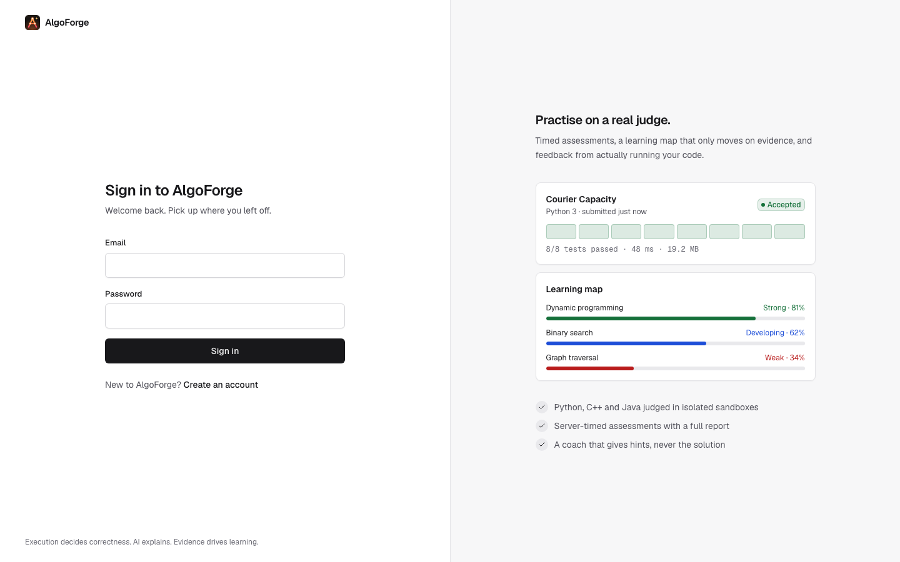
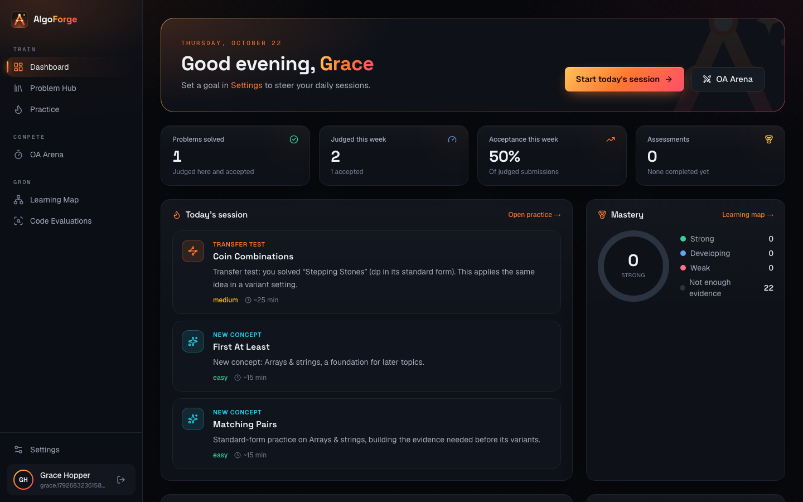
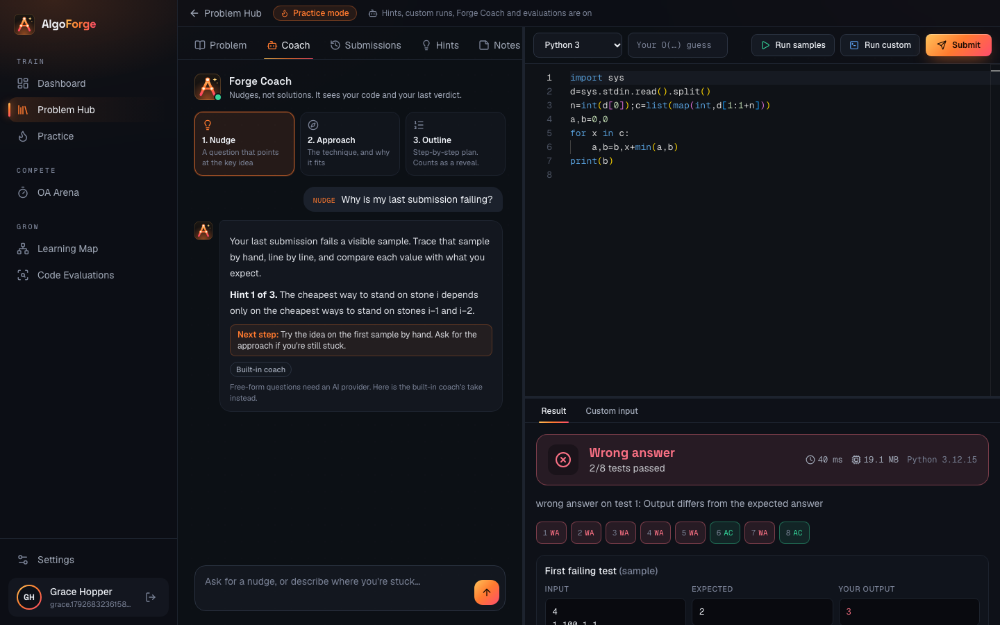
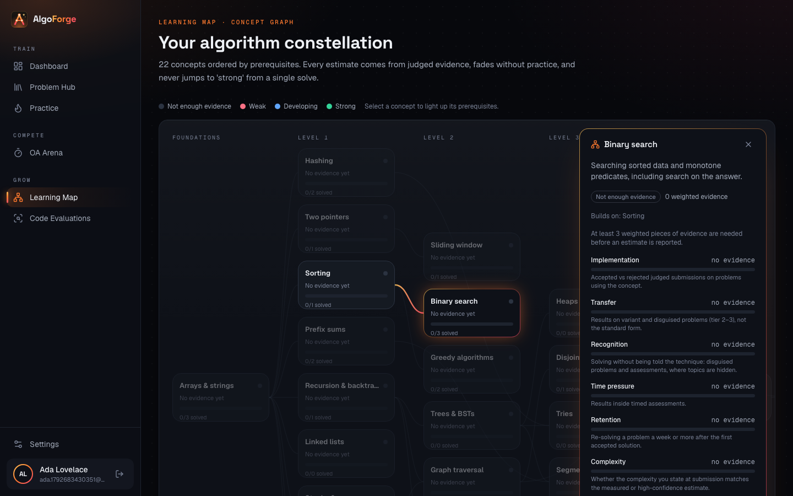
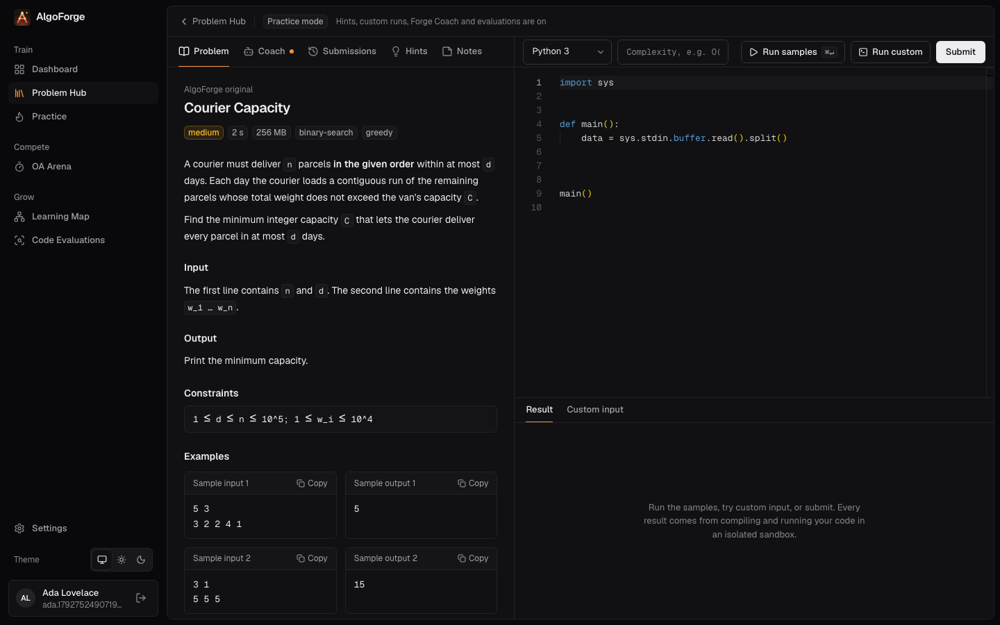

<p align="center">
  <picture>
    <source media="(prefers-color-scheme: dark)" srcset="frontend/public/brand/algoforge-logo.svg">
    
  </picture>
</p>

<p align="center"><b>Forge your algorithms.</b> Practise on a real judge, pressure-test yourself in timed assessments,<br>and learn from evidence, not guesswork.</p>

<p align="center">
  
  
  
  
</p>
<p align="center"></p>

AlgoForge is a platform for competitive programming practice and coding-assessment preparation. It has six parts:

- **Problem Hub**: original problems that are judged locally, plus problems from other platforms that are linked or synced, with deduplication and an honest per-platform capability panel. For a linked problem you can ask for an **original twin**: a new problem on the same technique, written by AI and judged here (see [Original twins](#original-twins)).
- **Practice Lab**: Monaco editor, runs on the samples or custom input, judged submissions with per-test verdicts, real time and memory measurements, hints, notes and an editorial.
- **Code evaluation**: every verdict comes from compiling and running the code in a Docker sandbox. A transparent, weighted report combines that execution evidence with static analysis. On request, a deep evaluation runs seeded random and AI-proposed inputs through an input validator and a trusted reference solution, keeps the smallest failing case, benchmarks accepted code, and asks the configured AI providers for a review. Disagreements are settled only by evidence.
- **OA Arena**: timed assessments built from templates or by hand, with server-side timing, deterministic scoring (partial credit and penalties), hidden test data during the run, and a post-assessment report with time per problem, a submission timeline, insights and follow-up problems.
- **Forge Coach**: an AI hint agent in the practice workspace. It reads the statement, your current code, your last verdict and the static analysis, and answers at the level you pick: a nudge, the approach, or a step-by-step outline. It never writes the solution (code blocks longer than six lines are stripped, even unclosed ones), an AI-written outline counts as a solution reveal, and it is switched off during assessments that forbid hints. Without an AI provider, a built-in coach answers from the problem's authored hints and a diagnosis of your last verdict.
- **Adaptive learning**: a 22-concept prerequisite graph with per-dimension estimates (implementation, transfer, recognition, time pressure, retention, complexity reasoning) built only from judged evidence. A transfer-test engine moves you from the standard form of a concept to variants and disguised problems, and the daily session explains every pick.

Guiding principle: execution decides correctness, reproducible measurements back performance claims, AI explains and assists, and recommendations follow demonstrated ability.

See [FEATURE_STATUS.md](FEATURE_STATUS.md) for what is implemented, tested, partial or unconfigured, and for known limitations.

## Architecture

```
 browser ──► web (Next.js 16, :3000) ──/api proxy──► api (Spring Boot 3.5, :8080) ──► PostgreSQL 16
                                                         │  (sessions, problems, jobs, reports, learning)
                                                         ▼
                                      execution_jobs table (FOR UPDATE SKIP LOCKED)
                                                         ▼
                              worker (same jar, profile "worker", no HTTP) ──docker──► sandbox containers
                                     │                                              (python / cpp / java images)
                                     └──► AI provider APIs (review, test proposals, coaching)
```

- **One backend codebase, two processes.** The API never executes code. The worker claims jobs from Postgres, runs them in disposable containers, and writes verdicts, evaluation reports and learning evidence. Postgres doubles as the job queue, so there is no Redis.
- **Sandbox** (`sandbox/`): one image per language built from the official `python:3.12-slim`, `gcc:14` and `eclipse-temurin:21-jdk` images plus `af-run`, a small runner that applies the wall-clock limit, measures time and peak memory with GNU `time`, caps output, and kills leftover processes.
- **Original problems** live in `backend/src/main/resources/seed/problems/<slug>/`, each with a statement, constraints, hints, an editorial, `ref.py` (trusted reference), `gen.py` (seeded generator), `validate.py` (input validator) and hand-written tests. Large hidden tests are generated in the sandbox on first use and answered by the reference solution. Every reference solution was cross-checked against an independent brute force on random small inputs.

## Quick start (local development)

Prerequisites: JDK 21, Maven 3.9+, Node 20+, and a running Docker daemon (Docker Desktop, or colima on macOS).

```bash
docker compose up -d db
```

```bash
sandbox/build.sh
```

Start the API (terminal 1):

```bash
cd backend && mvn spring-boot:run
```

Start the worker (terminal 2):

```bash
cd backend && mvn spring-boot:run -Dspring-boot.run.profiles=worker
```

Start the web app (terminal 3):

```bash
cd frontend && npm install && npm run dev
```

The worker checks at start-up that every sandbox image exists in the Docker daemon it talks to, and refuses to start if one is missing. Build the images against the same Docker context (`DOCKER_HOST`) the worker uses.

Open http://localhost:3000 and create an account. Flyway creates the schema and the 12 original problems are seeded on first API start. To import the Codeforces catalogue (about 11,000 problems, metadata only), open **Problem Hub → Sources → Codeforces → Sync**.

## Everything in containers

```bash
sandbox/build.sh
```

```bash
docker compose --profile full up -d --build
```

This starts `db`, `api`, `worker` and `web` (http://localhost:3000; the API is also on 127.0.0.1:8080). The worker container talks to the host's Docker daemon through `/var/run/docker.sock` to start sibling sandbox containers; read the security model below before exposing this anywhere.

## Configuration

Copy `.env.example` to `.env` (Docker Compose reads it automatically; for `mvn spring-boot:run`, export the variables in your shell). Never put keys in source files.

| Variable | Default | Purpose |
|---|---|---|
| `DATABASE_URL`, `DATABASE_USER`, `DATABASE_PASSWORD` | local compose database | PostgreSQL connection |
| Provider API keys (listed in `.env.example`) | empty | Enable the AI providers (server-side only) |
| `AI_DUAL_MODE` | `false` | Review with every configured provider and compare their claims |
| `AI_REQUESTS_PER_HOUR` | `20` | Per-user hourly cap on provider calls (cache hits are free) |
| `SANDBOX_RUNTIME` | empty | Docker runtime for sandboxes, e.g. `runsc` for gVisor |
| `WORKER_THREADS` | `2` | Concurrent jobs per worker |
| `COOKIE_SECURE` | `false` | Set `true` behind HTTPS |
| `REGISTRATIONS_PER_15_MINUTES`, `LOGINS_PER_15_MINUTES` | `5`, `10` | Auth rate limits (login is limited per account and per address) |
| `SUBMISSIONS_PER_MINUTE`, `RUNS_PER_MINUTE` | `10`, `20` | Per-user execution limits |
| `API_URL` (web build argument) | `http://localhost:8080` | Where the Next.js proxy forwards `/api` |

Scoring weights live in `backend/src/main/resources/application.yml` (`algoforge.scoring.weights`) and are normalised, so they need not sum to 100.

### AI providers

Models are data, not code: they are stored in the `ai_provider_configs` table, one row per provider, with the `REVIEW` and `TESTGEN` roles. Forge Coach uses the first enabled `REVIEW` provider. Change a provider's `model` or set `enabled = false` with SQL, for example:

```bash
docker compose exec db psql -U algoforge -c "update ai_provider_configs set enabled = false where provider = 'gemini'"
```

Without any key, every deterministic part still works: judging, generated tests checked by the reference solution, benchmarks, static analysis and scoring. Reports say "no AI provider configured" instead of inventing a review. With a key, the provider receives the problem, the code and the execution evidence, and must answer in a JSON schema. Replies are validated, length-capped, cached by a hash of the exact prompt, logged in `ai_usage`, retried once on transient errors, and never executed. AI-proposed test inputs must pass the problem's validator, and their expected output always comes from the reference solution. The model's own claimed output is kept only as an unverified label.

## Tests

Backend (99 tests: unit, integration against real PostgreSQL via Testcontainers, and real sandbox judging when the images are built):

```bash
cd backend && mvn test
```

With colima instead of Docker Desktop, point Testcontainers at colima's socket:

```bash
cd backend && DOCKER_HOST=unix://$HOME/.colima/default/docker.sock TESTCONTAINERS_DOCKER_SOCKET_OVERRIDE=/var/run/docker.sock mvn test
```

Opt-in live tests (skipped by default) call the real services. Export the provider keys from `.env.example` first:

```bash
cd backend && LIVE_TESTS=1 mvn test -Dtest=LiveIntegrationTest
```

End-to-end browser journeys (register, practise, run, submit, evaluation, deep evaluation, Forge Coach, timed OA to report, completing a recommendation, sign-in guard). They need the stack running (either quick start or containers) and submit each problem's Python reference solution as the known-correct answer:

```bash
cd frontend && npx playwright install chromium && npm run test:e2e
```

Frontend static checks:

```bash
cd frontend && npm run lint && npm run typecheck
```

## Security model

**Untrusted code** runs only in the worker's disposable containers, one per job, never in the API:

- no network access (`--network none`)
- a read-only root filesystem, with writable paths only on size-capped tmpfs
- UID 65534, all capabilities dropped, `no-new-privileges`
- memory and swap limits, `--cpus 1`, `--pids-limit 128`, capped file descriptors and output file size, no core dumps
- wall-clock limits enforced inside (`timeout`) and outside the container
- after every run, `af-run` kills anything the program left running, and a reaper process keeps PID 1 from accumulating zombies
- containers delete themselves after 25 minutes even if the worker dies

Fork bombs, memory bombs, output floods, orphaned processes and network access were tested against this setup.

**Docker is not treated as a complete boundary:**

- Set `SANDBOX_RUNTIME=runsc` to add gVisor.
- Run the worker on a dedicated machine. Access to the Docker socket is root-equivalent on that host.
- Give the worker only database credentials and AI keys. Sandboxes never receive environment variables.

**Web:**

- Authentication uses server-side sessions stored in PostgreSQL (Spring Session JDBC), in an HttpOnly, SameSite=Lax cookie. Set `COOKIE_SECURE=true` behind HTTPS.
- Every mutating request needs the double-submit CSRF token.
- Passwords are hashed with BCrypt (at most 72 bytes, BCrypt's input limit).
- Login is rate-limited per account and per address; registration, submissions, runs, syncs, deep evaluations and AI calls are rate-limited too.
- Hidden test data, editorials and evaluations are withheld server-side while an assessment runs, even when it allows hints; hints and Forge Coach are withheld unless it does.
- Logins, registrations, solution reveals (editorials and AI outlines) and syncs are written to `audit_log`.
- Retention jobs prune the AI cache, old jobs, usage logs and audit entries.

**Proxies:** the API reads client addresses with Tomcat's `RemoteIpValve`, which walks `X-Forwarded-For` right to left through trusted private-network proxies only. Next.js rewrites forward a client-sent `X-Forwarded-For` unchanged and add none of their own. In production, put a reverse proxy or load balancer in front of the web app that sets `X-Forwarded-For` to the real client address, and do not expose the API port publicly. Login limits are also keyed by account, so a forged header cannot bypass them.

## Problem sources

| Source | Integration | What works |
|---|---|---|
| AlgoForge originals | Bundled | Full statements, samples, hidden tests, local judging, editorials, reference solutions |
| Codeforces | Official API `problemset.problems` | Catalogue sync (titles, ratings, tags mapped to concepts), canonical links, dedupe of problemset/contest URLs. Statements and judging stay on Codeforces |
| LeetCode, CodeChef, AtCoder, CSES, HackerRank | Link only | URL parsing to platform IDs, canonical links, dedupe, notes and status. Nothing is scraped |
| Any other site | Link only | Normalised URL, notes and status |
| Your own problems | `POST /api/problems` | Private original problems with author tests |
| Original twins | AI-written, sandbox-verified | A private problem on the same technique as a linked one, judged locally |

Each adapter declares its capabilities (discovery, metadata sync, statements, examples, links, verdict sync, judging, ratings and tags). The Problem Hub shows exactly what each source supports.

### Original twins

AlgoForge does not copy statements from other sites, and renaming the nouns in someone else's problem would still copy it. Instead, a linked problem's page offers to create an original twin (`POST /api/problems/{id}/twin`, 5 per hour):

1. The worker sends the AI only the problem's concepts, tags and difficulty, never its title, link or text. The AI writes a new problem: statement, constraints, samples, hints, an editorial, a reference solution, an independent brute force and a seeded input generator.
2. All of that code runs only in the Python sandbox. The reference and the brute force must agree on the samples and on 15 random small inputs, and the reference must finish within the time limit at full size.
3. If a check fails, the failure goes back to the AI once for a corrected problem. If the second attempt also fails, the job reports why and nothing is saved.
   If a provider fails outright (down, or out of credit), the next configured provider is tried. A twin usually takes 2 to 5 minutes, mostly the AI's thinking, so the worker allows AI calls up to 600 s.
4. A verified twin is saved as your private original problem with its samples and 9 hidden tests. It is linked both ways to the source problem and keeps the source's concepts, so solving it counts as learning evidence.

The checks catch a wrong reference only when the brute force gets it right; both come from the same model, so a twin is less certain than a hand-checked original. Its page marks it as AI-written.

## Adding an original problem

Create `backend/src/main/resources/seed/problems/<slug>/` with:

| File | Contents |
|---|---|
| `problem.json` | Title, difficulty, limits, constraints, concept tiers, hints, sample IDs, generator specs |
| `statement.md` | The statement |
| `editorial.md` | The editorial |
| `ref.py` | Trusted reference solution |
| `gen.py` | Seeded generator, called as `<seed> <n>` |
| `validate.py` | Input validator; exits non-zero on invalid input |
| `tests/NN.in`, `tests/NN.out` | Hand-written tests |

Copy an existing problem as a template, and cross-check `ref.py` against a brute force before trusting it. Seeds are inserted only when the slug is missing, so editing an existing problem needs a migration.

## Design system

The interface follows one written standard, so every screen looks like part of the same product:

- **Tokens, not colours.** Surfaces (`bg`, `panel`, `panel-2`, `panel-3`), borders (`line`, `line-strong`), text (`fg`, `muted`, `faint`), one accent and five status colours are CSS variables in `frontend/src/app/globals.css`. Light and dark themes share the names; every text token meets WCAG AA (4.5:1) on every surface in both.
- **Light and dark.** The theme follows the system by default and can be pinned to light or dark from the sidebar or Settings. An inline script applies it before the first paint, so pages never flash the wrong theme.
- **One accent, used sparingly.** Forge orange marks focus, the active page, links and progress. Primary buttons are neutral (near-black in light, near-white in dark). The only gradient is the logo mark.
- **Type and spacing.** Geist for text, Geist Mono for code and figures; a fixed scale (12, 13, 14, 16, 20, 24 px) on a 4 px spacing grid. Controls use a 6 px radius, cards 8 px, with hairline borders instead of shadows and glows.
- **Motion with a purpose.** Content enters with a short fade-and-rise, numbers count up, bars and rings grow from zero, the judge shows live Queued, Compiling and Running steps, an accepted verdict draws its check mark, coach replies type themselves out, the learning map's prerequisite edges flow toward the selected concept, and the theme switch spreads out in a circle from the control. Everything stops for reduced motion.
- **Keyboard first.** ⌘K / Ctrl+K opens a command palette: jump to any page, search problems by title, open a random unsolved problem, switch theme or sign out.
- **Shared components.** `frontend/src/components/ui.tsx` holds the building blocks every page uses: `Page`, `PageHeader`, `Card`, `Button`, `Badge` (with semantic tones), `Segmented`, `TabBar`, `StatStrip`, form fields and empty, loading and error states.

### Brand

The mark is an "A" drawn as a small graph: three nodes joined by edges, with a spark for the idea that clicks. It is used for the favicon, the sidebar, the sign-in page and Forge Coach's avatar.

| Asset | Use |
|---|---|
| `frontend/public/brand/algoforge-mark.svg` | The square mark (also `frontend/src/app/icon.svg`, the favicon) |
| `frontend/public/brand/algoforge-logo.svg` | Mark and wordmark for dark backgrounds |
| `frontend/public/brand/algoforge-logo-light.svg` | Mark and wordmark for light backgrounds |
| `frontend/src/components/Logo.tsx` | `LogoMark` and `Logo` React components |

## API documentation

OpenAPI JSON is served at `/api/docs` and Swagger UI at `/api/docs/ui` on the API port.
